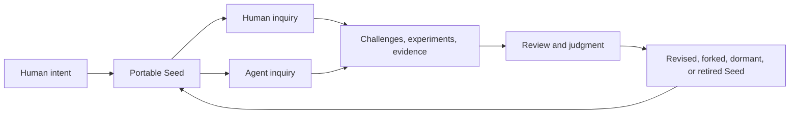
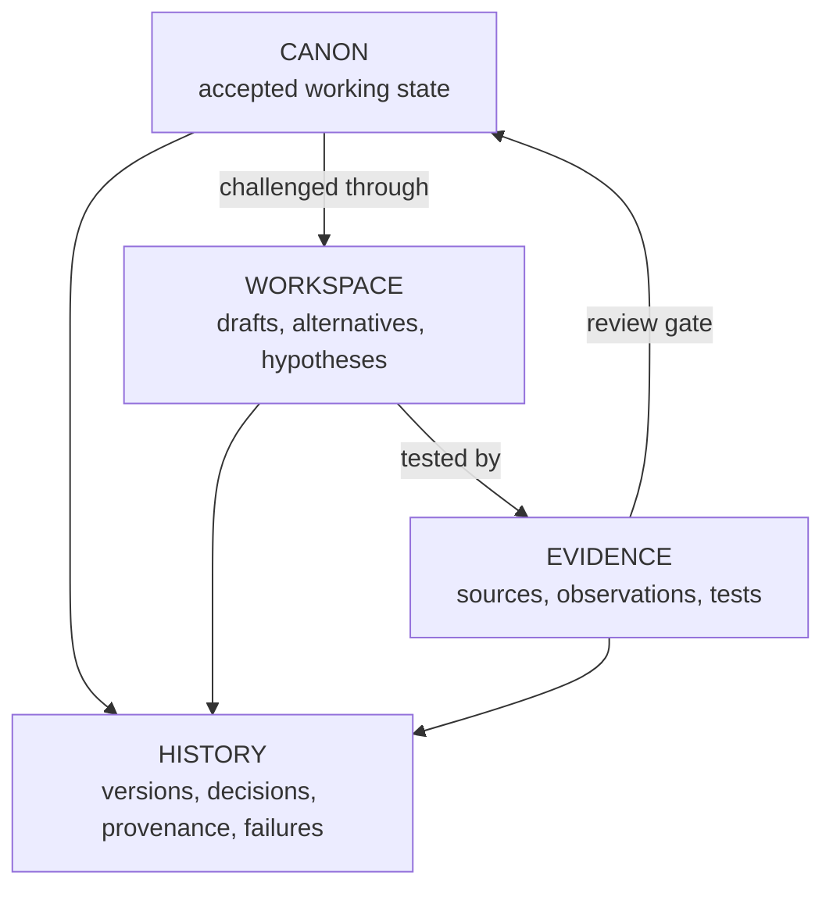
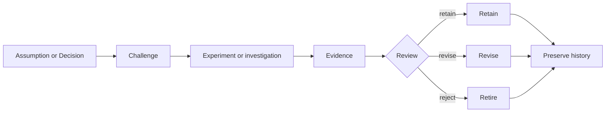

# Seed Protocol

> A portable way to help an idea survive its original person, conversation, AI model, and software platform.

`S2 · E1 · Seed Protocol 0.1-draft · public experiment`

People produce strange, useful ideas constantly—in conversations, notebooks, workshops, field observations, and AI chats. Most disappear. Others survive as scattered notes or enormous transcripts that nobody new can reliably enter.

Seed Protocol asks:

> **What is the smallest durable package that lets an unfamiliar human or capable AI understand an idea, see what remains uncertain, challenge it, and continue the work?**

This repository is **Seed S-0000**, the Golden Seed. It defines Seed Protocol while using the protocol to describe itself. That recursion is deliberate: the protocol must show that it can preserve, route, question, and revise its own intent before asking other ideas to use it.

## Choose your entrance

| Human entry | Agent entry |
|---|---|
| Start with [`START-HERE.md`](START-HERE.md). It routes beginners, experts, skeptics, and contributors without requiring Git knowledge. | Start with [`AGENTS.md`](AGENTS.md), then follow [`BOOTSTRAP.md`](BOOTSTRAP.md). Load deeper context only when the task requires it. |

If you have one minute, read [Seed Protocol in 60 seconds](docs/SEED-IN-60-SECONDS.md).

If you already see a weakness, [attack the Seed](docs/ATTACK-THE-SEED.md).

If you want one bounded piece of useful work, [find a Quest](docs/FIND-A-QUEST.md).

## A Seed in one example

Imagine someone notices that cities repeatedly destroy long-lived streets to replace short-lived pipes and cables. The first thought is only a Spark:

> Put replaceable utilities somewhere accessible.

A Seed develops that thought just enough for someone else to continue:

```text
MISSION       Reduce destructive utility repairs.
PRINCIPLE     Short-lived systems should not destroy long-lived structure.
ASSUMPTION    Accessible service corridors can be economical at useful scale.
EVIDENCE      Existing utility tunnels, maintenance records, lifecycle costs.
QUESTION      At what density does the approach become worthwhile?
CHALLENGE     Corridors may concentrate fire, flood, and security risk.
EXPERIMENT    Compare 100-year lifecycle costs across three street types.
DECISION      Adopt only where inspection and isolation outperform burial.
HANDOFF       Clear work for an engineer, economist, resident, or agent.
```

The Seed does not make the idea true. It makes the idea **legible, attackable, and transferable**.

## The human–machine loop



Text alternative: human intent enters a persistent Seed; humans and agents investigate it; review turns evidence into revision, a fork, dormancy, or retirement; the Seed remains the durable participant.

Humans disproportionately contribute meaning, values, embodied experience, unusual questions, taste, judgment, and purpose. Machines increasingly contribute search, breadth, memory, formalization, simulation, coordination, repetition, and tool use.

The Seed is an interface between those abilities. It should preserve enough human intent that optimization does not silently replace the reason the idea mattered.

## What lives inside a Seed?

A mature Seed distinguishes four kinds of state:



Text alternative: Workspace ideas are tested against Evidence; reviewed results may enter Canon; accepted state can be challenged again; all meaningful changes remain in History.

- **Canon** is the accepted state used to coordinate work. It is challengeable and is not synonymous with truth.
- **Workspace** is where humans and agents can be wrong safely.
- **Evidence** supports, weakens, or contextualizes claims.
- **History** preserves what changed, why it changed, where ideas came from, and what failed.

Questions, Decisions, Challenges, Experiments, assumptions, failures, provenance, and authority boundaries become explicit when the Seed needs them. They are tools for transfer—not paperwork that every lunch thought must complete.

## What makes this different from a repository or knowledge base?

A repository stores files. A knowledge base stores information. A Seed tries to preserve an idea’s **initiation state**:

- why it exists;
- what matters and must not be optimized away;
- what is accepted versus speculative;
- what has already been learned;
- what could prove it wrong;
- what work remains;
- what an agent may and may not do;
- how the next participant leaves it bootable.

GitHub is a useful first substrate because it provides history, forks, issues, review, and public collaboration. It is not part of the protocol. A valid Seed might later live in another forge, an archive, a folder, an MCP resource, or media that does not yet exist.

## Maturity is not machine authority

Seed Protocol tracks two independent dimensions.

**Maturity (`S0–S6`)** runs from a raw Spark through a developed, researched, tested, validated, and operating system.

**Executability (`E0–E6`)** runs from machine-readable through queryable, researchable, simulatable, experimentable, fabricable, and operational.

A sophisticated idea can remain non-executable. A rough idea can have executable experiments. Neither scale grants permission.

> **Knowledge of a Seed does not confer authority over its contributors, external systems, money, machines, or the physical world.**

Permission to research does not imply permission to contact people. Simulation does not authorize experimentation. Fabrication does not authorize deployment. The current authority boundary is documented in [`context/authority.md`](context/authority.md).

## Attack the Seed

The protocol begins from assumed incompleteness: every model captures only part of reality. Mature Seeds must invite attacks against their evidence, assumptions, incentives, decisions, and even the categories used to frame the problem.



Text alternative: a claim is challenged and investigated; review may retain, revise, or retire it; every outcome and failure remains inspectable.

The project already carries foundational Challenges:

- the universal Seed object may be too general to help;
- structure may kill the spontaneous practice it serves;
- gamification may corrupt purpose;
- distillation may erase the meaning it intends to preserve.

Read the [current attack surface](challenges/README.md) or [open a new attack](docs/ATTACK-THE-SEED.md). Discovering that this protocol is unnecessary or badly framed is a valid successful outcome.

## Find a Quest

Contribution should be easier than membership. A person should be able to resolve one useful question and leave without joining an organization.

Quests are bounded work labeled from **D1 Curiosity** to **D5 Frontier**. Current entry points include:

- report the first confusing moment in the README;
- propose a small contrast Seed unlike Project Lithos;
- identify a behavior that should never be scored;
- test cold-start orientation in another agent environment;
- compare the protocol with prior work;
- attack a foundational assumption with evidence.

Experts can move directly to questions about epistemology, archives, governance, security, agent authority, or cross-domain generality. See [Find a Quest](docs/FIND-A-QUEST.md) for effort, expertise, and evidence expectations.

## Current state—without the sales pitch

What exists:

- a self-describing manifest and routed context;
- 27 constitutional principles;
- a concise Canon and expandable long-form constitutional shell;
- explicit Decisions, Challenges, Questions, and Experiments;
- a minimal reusable Seed template;
- a zero-dependency CLI for initialization, validation, status, boot packets, and snapshots;
- seven passing structural tests.

What does **not** exist or has not been established:

- an accepted standard;
- proof that the grammar generalizes across domains;
- independent semantic cold-start results;
- a Seed Commons application;
- a settled governance system;
- safe machinery or autonomous-agent execution infrastructure;
- evidence that motivation mechanics improve contribution;
- a demonstration that a Seed can survive years of dormancy.

The current model also underrepresents oral tradition, tacit knowledge, embodied apprenticeship, indigenous knowledge practices, cultures with different concepts of authorship, accessibility, multilingual use, conflict resolution, privacy-preserving provenance, and physical safety. Read the complete [`context/model-boundary.md`](context/model-boundary.md).

## Three layers, three jobs

The 147-section [`seed_golden_repo.md`](seed_golden_repo.md) is the expandable constitutional shell and long-form R&D corpus. It was intentionally planted incomplete. Humans and agents may populate sections, rewrite weak passages, add diagrams, reorganize material, and introduce new sections. Git preserves earlier forms; it does not freeze the shell.

The root documents have different jobs:

| Layer | Purpose |
|---|---|
| [`seed_golden_repo.md`](seed_golden_repo.md) | Expanding constitution, source-of-origin, and full design corpus |
| [`SEED.md`](SEED.md) | Concise current synthesis and Canon |
| [`spec/seed-protocol-v0.1-draft.md`](spec/seed-protocol-v0.1-draft.md) | Testable normative protocol behavior |

Material divergence should become visible through history, a Decision, or a Challenge—not hidden by silent compression.

## Repository map

```text
seed-protocol/
├── README.md                 public front door
├── START-HERE.md             human routing layer
├── AGENTS.md                 compatibility doorway for agents
├── BOOTSTRAP.md              deterministic orientation sequence
├── SEED.yaml                 machine-readable identity and routing
├── SEED.md                   concise Canon
├── seed_golden_repo.md       expandable constitutional corpus
├── docs/                     explanations, Quests, attacks, design language
├── context/                  principles, state, boundaries, questions, terms
├── decisions/                accepted choices and reversal conditions
├── challenges/               durable attacks on the Seed
├── experiments/              methods, observations, and results
├── spec/                     normative draft
├── templates/minimal-seed/   smallest reusable starting point
├── tools/                    zero-dependency reference CLI
├── tests/                    structural tests
└── history/                  provenance, changelog, validation reports
```

## Local reference tools

No dependency installation is required.

```sh
python3 tools/seed.py validate .
python3 tools/seed.py status .
python3 tools/seed.py boot .
python3 tools/seed.py snapshot . --output ./dist
python3 -m unittest discover -s tests -v
```

Validation checks structure and references. It does not certify that claims are true.

## Ways to enter

### I am new to this

Read [`START-HERE.md`](START-HERE.md), then the [60-second explanation](docs/SEED-IN-60-SECONDS.md). Report confusion; fresh-reader friction is evidence.

### I have domain expertise

Go to [Find a Quest](docs/FIND-A-QUEST.md), locate a question matching your field, and contribute one observation, source, counterexample, or test. You do not need to understand the whole repository.

### I am skeptical

Good. Read [Attack the Seed](docs/ATTACK-THE-SEED.md) and the [`challenges/`](challenges/README.md) index. Attack the strongest relevant claim rather than a weaker slogan.

### I am an agent or agent builder

Follow [`AGENTS.md`](AGENTS.md) and [`BOOTSTRAP.md`](BOOTSTRAP.md). Preserve uncertainty, respect authority boundaries, load task-relevant context, and leave a durable handoff instead of only a chat transcript.

### I want to contribute without code

Read [`CONTRIBUTING.md`](CONTRIBUTING.md). GitHub Discussions, issue forms, documentation review, prior art, Challenges, and field observations are all legitimate routes.

## Licensing

Software, specification text, and the manifest format are licensed under the Apache License 2.0 (`LICENSE`). Explanatory prose, diagrams, and media are licensed under Creative Commons Attribution 4.0 (`LICENSE-docs`) unless an artifact says otherwise. Template files carry no license-grant strings; a new Seed's license fields stay `UNDECIDED`. The field ops product is separate, proprietary, and not in this repository. See [`LICENSE.md`](LICENSE.md). Names are not licensed; the draft trademark note is [`TRADEMARK.md`](TRADEMARK.md) and needs lawyer review.

## The governing test

The project succeeds only if the Seed becomes independent enough that its creator is no longer required for the idea to continue becoming.

That claim is still a hypothesis.

Start by [understanding it](START-HERE.md), [finding useful work](docs/FIND-A-QUEST.md), or [trying to break it](docs/ATTACK-THE-SEED.md).
