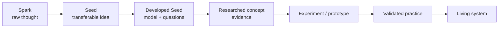
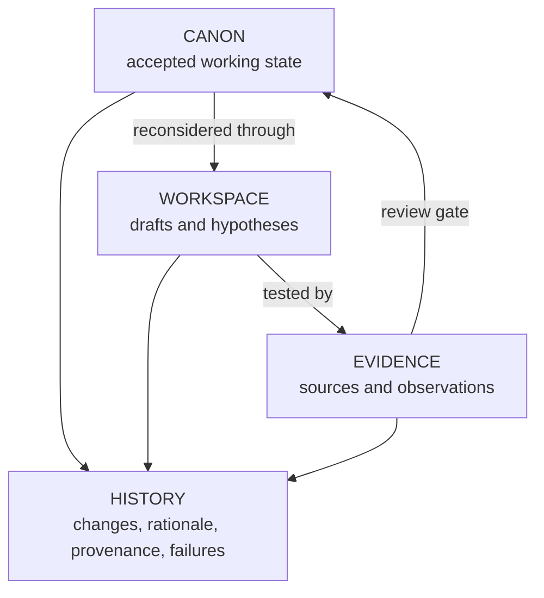
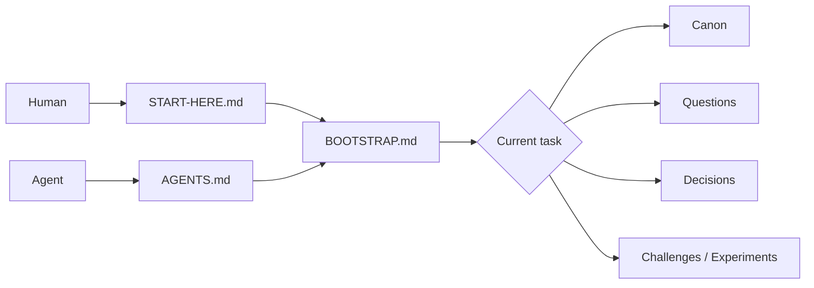
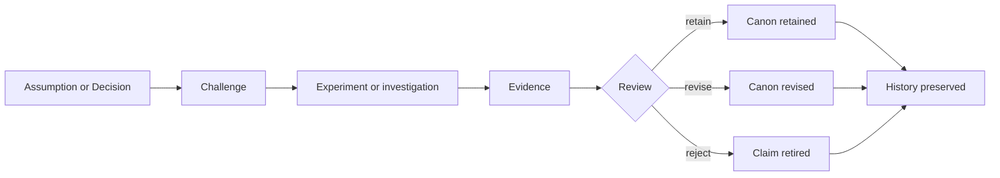

# How Seeds work

This is the explanatory model. The normative draft remains in [`spec/seed-protocol-v0.1-draft.md`](../spec/seed-protocol-v0.1-draft.md).

## 1. Capture a Spark

A Spark is a raw thought worth retaining: a sentence, sketch, question, observation, or conversation. Capture should be nearly frictionless. Most Sparks never need a formal Seed.

## 2. Promote only when transfer matters

A Spark becomes a Seed when someone wants another person or agent to continue without reconstructing the origin. The smallest useful Seed (working assumption until X-0001b; the minimum is the smallest Seed that still passes a cold start, D-0009) identifies the idea, its purpose, its current state, and where to begin.

Text alternative: maturity runs from S0 raw Spark through S1 transferable Seed, S2 developed model, S3 researched concept, S4 experiment, S5 validated practice, and S6 operating system. Movement is not automatic or always desirable.

## 3. Separate four kinds of state

Text alternative: Workspace ideas are tested through Evidence; reviewed conclusions may enter Canon; all meaningful changes, rationale, and failures remain in History.

- **Canon** coordinates work. It is authoritative but challengeable, not synonymous with truth.
- **Workspace** gives participants room to be wrong safely.
- **Evidence** supports, weakens, or contextualizes claims.
- **History** preserves version changes, decision rationale, provenance, and useful failure.

## 4. Give every participant an entry route

Text alternative: humans enter through Start Here and agents through AGENTS; both reach the Bootstrap, which routes task-specific reading into Canon, Questions, Decisions, Challenges, and Experiments.

Agents follow a nine-stage boot sequence: discover, orient, anchor, select, retrieve, verify, act, record, and hand off. Context is loaded in layers rather than dumped into one enormous prompt.

## 5. Keep maturity separate from executability

Maturity asks how well an idea has been investigated and demonstrated. Executability asks what bounded machine work it can initiate.

| Level | Machine executability |
|---|---|
| E0 | Readable |
| E1 | Queryable and bootable |
| E2 | Researchable by agents |
| E3 | Simulatable |
| E4 | Experimentable in approved environments |
| E5 | Fabricable with approval and controls |
| E6 | Operational within bounded authority |

Knowledge is not authority. Permission to research never silently becomes permission to purchase, contact people, fabricate, or operate machines.

## 6. Make disagreement durable

A Decision records a choice and what would reverse it. A Challenge records a serious attack. An Experiment records a method for reducing uncertainty. A failure remains valuable when it prevents repeated error.

Text alternative: an assumption is challenged, investigated, and reviewed; Canon may be retained, revised, or rejected, while the complete reasoning remains in History.

## 7. Let Seeds sleep or fork

Dormancy is legitimate. Before a Seed sleeps, it should leave a concise status and handoff. Fundamental disagreement may create a derivative Seed with declared ancestry instead of forcing consensus.

## 8. Keep the protocol smaller than the possibility

Seed Protocol currently uses plain text, open formats, and a small reference CLI. GitHub is the first collaboration adapter, not part of the protocol itself. Seed Commons, semantic graphs, reputation systems, and physical execution remain future hypotheses.

## Current evidence limit

S-0000 proves that the structure can describe itself and pass local structural tests. It does not prove that the same structure helps creative work, communities, science, or long-lived projects. That is why the next work is testing—not platform construction.

Next: [find a Quest](FIND-A-QUEST.md), [attack the Seed](ATTACK-THE-SEED.md), or inspect the [model boundary](../context/model-boundary.md).
