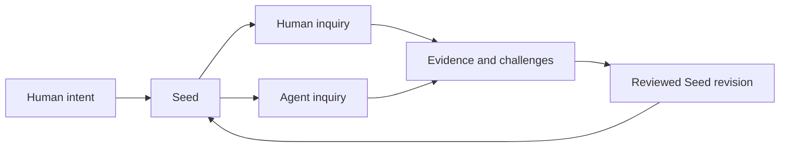

# Seed Protocol in 60 seconds

## The problem

People have valuable ideas in conversations, notebooks, field work, and AI chats. Most disappear. Others survive as piles of context that nobody new can reliably enter.

Seed Protocol asks:

> What is the smallest durable package that lets an unfamiliar human or AI understand an idea, see what is uncertain, challenge it, and continue the work?

## A tiny example

Imagine a lunch conversation produces this idea:

> Cities should place replaceable utilities in accessible service corridors instead of repeatedly cutting open durable streets.

A note preserves the sentence. A Seed preserves enough to continue:

```text
MISSION       Reduce destructive utility repairs.
PRINCIPLE     Short-lived pipes should not require destruction of long-lived streets.
ASSUMPTION    Accessible corridors can be economical at district scale.
EVIDENCE      Existing common-service tunnels and lifecycle cost studies.
QUESTION      At what density does the corridor become worthwhile?
CHALLENGE     Corridors may concentrate failures and security risks.
EXPERIMENT    Compare 100-year lifecycle costs in three street types.
DECISION      Adopt only if inspection and isolation outperform buried utilities.
HANDOFF       What an engineer, economist, or skeptical resident can do next.
```

The Seed does not declare the idea correct. It makes the idea legible, attackable, and transferable.

## Why agents matter

An AI should not need the chat that created the project. It should be able to read a compact entry point, locate Canon and uncertainty, understand what it may do, retrieve deeper context only when needed, and leave a useful handoff.



Text alternative: human intent enters a persistent Seed; humans and agents investigate it; evidence and challenges pass through review; accepted changes revise the Seed.

## What a Seed is not

A Seed is not necessarily a startup, repository, paper, prompt, specification, or finished project. It is the persistent intellectual chassis underneath whichever of those later become useful.

## The promise and the test

The promise is that an idea can outlive its original context without becoming frozen doctrine.

The test is whether unfamiliar people and agents can orient accurately, contribute without the creator, preserve uncertainty, and improve or disprove the idea. That has not yet been demonstrated across domains.

## Choose your next route

- [See how the pieces work](HOW-SEEDS-WORK.md)
- [Find a bounded Quest](FIND-A-QUEST.md)
- [Attack the protocol](ATTACK-THE-SEED.md)
- [Return to Start Here](../START-HERE.md)
